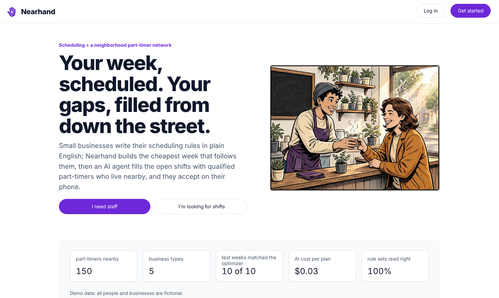
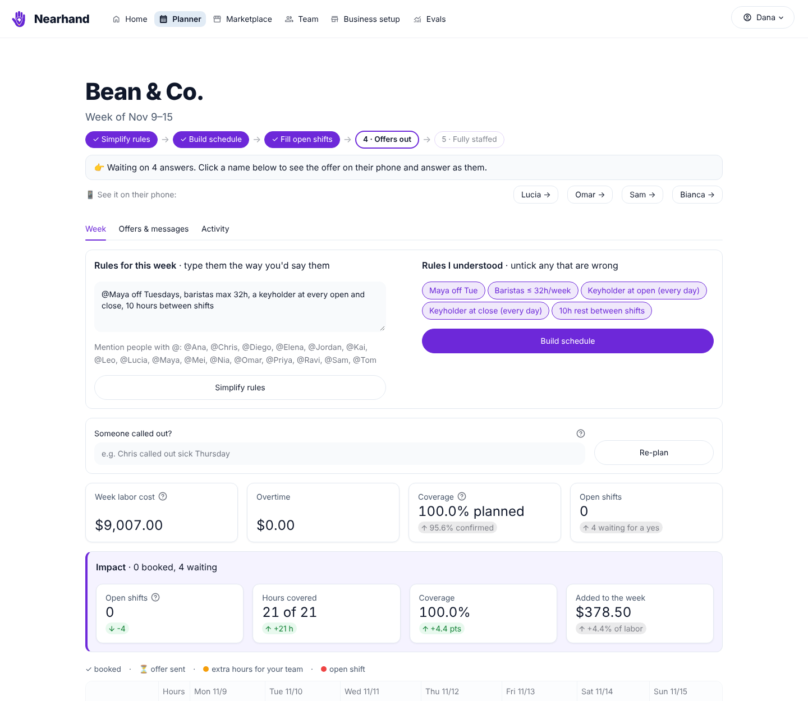
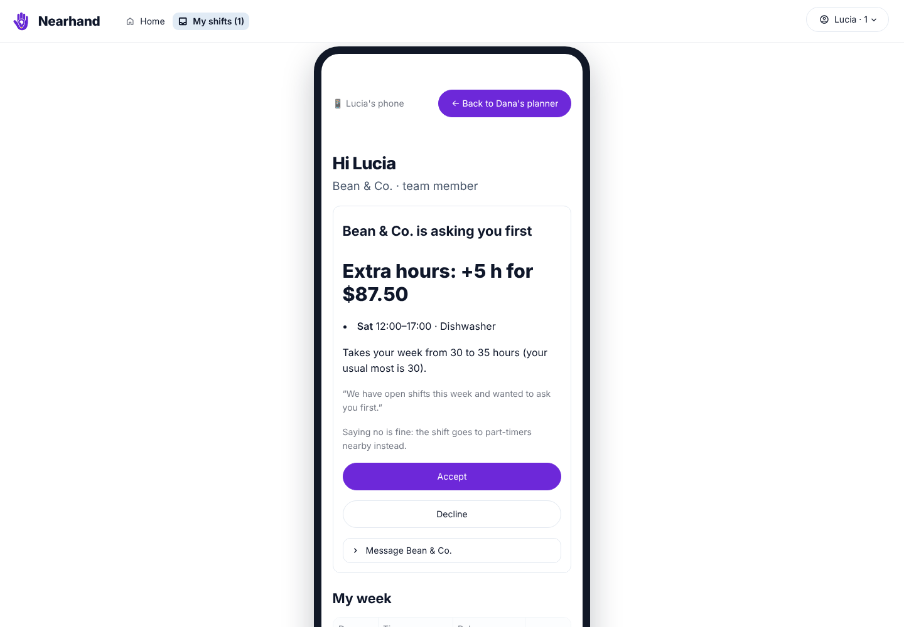
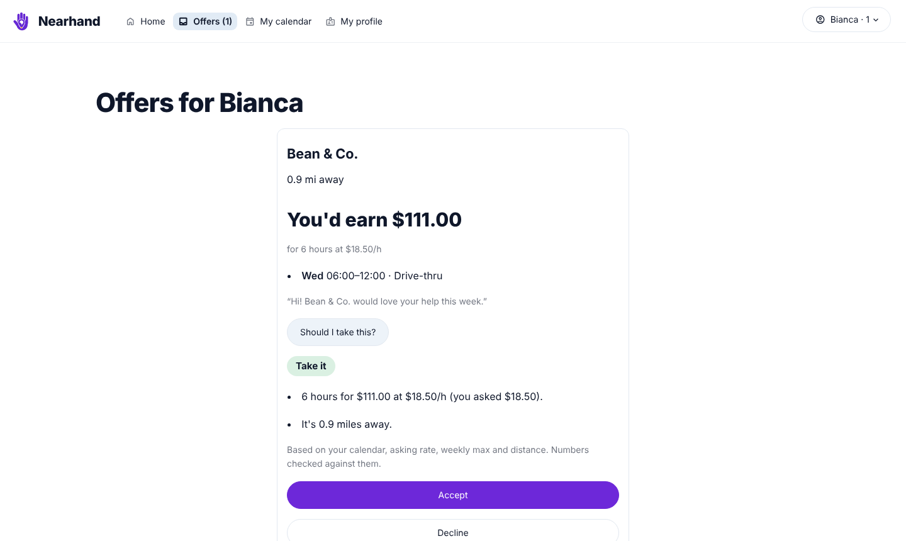
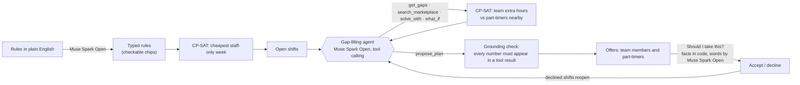
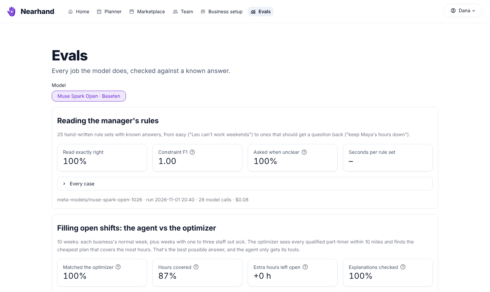

# Nearhand

**Your week, scheduled. Your gaps, filled from down the street.**

Nearhand is scheduling for small businesses (cafés, restaurants, bakeries, quick service and shops) with a
neighborhood part-timer network built in. An owner writes their rules the way they'd say them
("@Maya off Tuesdays, a keyholder at every open and close"). Nearhand builds the cheapest week that follows
them. An AI agent then fills the open shifts, asking the owner's own team first and then qualified
part-timers who live nearby. Everyone accepts or declines on their phone, and nothing is booked without a yes.

- **Live app:** [nearhand.streamlit.app](https://nearhand.streamlit.app)  (one click on *I need staff* or *I'm looking for shifts*; demo accounts, no password)
- **3-minute demo:** VIDEO_URL
- **Short on time?** Click **▶ Take the 2-minute tour** on the home page: it shows what to click at each step.
- Built during the **Meta Global AI Developer Hackathon**, Oct 29 – Nov 4, 2026 (Indie track).



## What it does

| Who | What they get |
| --- | --- |
| **Owner / shift manager** | Rules in plain English become checkable rules. One click builds the cheapest week that follows them (OR-Tools CP-SAT). "Fill gaps with AI" proposes who covers each open shift and what it adds to the week, before anything is sent. A next-step hint, a message thread with each person, and an Activity log of everything that happened this week. "Chris called out sick Thursday" reopens his shifts and the agent fills them; when someone says no, the agent sends the next-best person the offer on its own; a request in chat like "can I do 8 to 12 instead?" becomes a checked, one-click change. "See it on their phone" opens any person's inbox in a phone frame. |
| **Team member** | "Bean & Co. is asking you first": open shifts offered as extra hours, with the pay, the overtime and how it changes their week. Accept, or say no and the shift goes to the neighborhood. They can message the owner about any offer. |
| **Part-timer** | Offers from places nearby at their asking rate, around their calendar. "Should I take this?" gives a short, honest recommendation checked against their calendar, weekly max, pay and distance. A message thread with the business on every offer. |

| The owner's week, with the impact of a fill | A team member's extra-hours ask | A part-timer's offer |
| --- | --- | --- |
|  |  |  |

## How it works

**The model talks; the optimizer decides.** Muse Spark Open reads language, makes decisions about what to
try next, and explains. It never assigns a shift or computes a dollar: every schedule and every number comes
from the optimizer, and every number the model writes is checked against the optimizer's results before
anyone sees it.



- **Optimizer:** OR-Tools CP-SAT in two stages. First it covers as many hours as possible, then it finds the
  cheapest way to staff that coverage. It handles quarter-hour shifts, money in integer cents, weekly caps,
  overtime past 40 hours at the overtime rate, rest between shifts, required skills at open and close, one
  booking fee per part-timer, and fixed seeds for repeatable answers.
- **Ask the team first:** the optimizer may give an open shift to an employee as extra hours (up to a cap the
  owner sets, overtime optional) when that's cheaper than a part-timer plus the booking fee, or when nobody
  nearby qualifies. At the demo restaurant, no part-timer within 10 miles holds both the manager keys and the
  food-safety certificate, so those shifts go to the two certified managers as extra hours.
- **Agent:** Muse Spark Open with tool calling, at most 8 turns. If it doesn't finish, a fixed
  gaps → search → solve sequence takes over. Its explanation is replaced by a template if it quotes any
  number that isn't in a tool result.
- **Replacement rounds:** a decline reopens the shift. The next round fills only what reopened, holds pending
  offers, and never asks the same person again.
- **Every model call** goes through one client (`core/llm.py`) with a disk cache, retries on rate limits, a
  JSON-schema output with one validation retry, and a cost log (tokens, seconds, dollars) shown on the Evals page.

## Meta AI tooling

| Tool | Where it's used |
| --- | --- |
| **Muse Spark Open** (open weights, served on **Baseten**; Fireworks as a fallback host) | Nine jobs in the product: reading the owner's rules, adjusting the staffing template to the business, reading a pasted team list, reading a part-timer's work history at sign-up (including days they can't work), the marketplace search box, the gap-filling agent, "Should I take this?" offer advice, turning a chat message ("can I do 8 to 12 instead?") into a proposed shift change, and reading a sick call when it's worded loosely (plain ones like "Chris called out sick Thursday" are read in code). |
| **Muse Image** | The logo and the comic-style homepage and log-in pictures (`scripts/make_logo.py`, `scripts/make_art.py`). |
| **Muse Code** | The UI redesign and the home page, each from a written brief and task (`design/`), with the test suite as the acceptance check. See the commits *UI redesign by Muse Code* and *Home page by Muse Code*. |

## Evals

Every job the model does is checked against a known answer (`evals/`, results on the app's Evals page).

| Suite | What's checked | Result (Muse Spark Open on Baseten) |
| --- | --- | --- |
| Reading rules | 25 hand-written rule sets with known answers, including ones that should come back as a question | 25/25 exactly right; asked a question every time a rule was unclear |
| Gap-filling agent | 10 weeks (normal weeks, and weeks with 1–3 staff out sick) against the optimizer with every part-timer within 10 miles | Matched the optimizer's coverage in 10/10 weeks (within 1% of its cost); widened its own search beyond 5 miles in 9/10; about 2.6¢ and 15 s per plan |
| Offer advice | 20 offers with a clear right answer (good fit, clash, outside stated hours, over weekly max, below asking rate) | 20/20 right; no unsafe "take it" |

**The evals found a real problem and confirmed the fix.** In the first run, only 7 of 10 agent explanations
passed the number check. The agent was working out its own figures ("235 hours covered", "within 2–6 miles")
because the tools never reported them. After the tools started returning coverage counts and the prompt
forbade arithmetic, **10 of 10 passed**. The run history is on the Evals page. A full eval run costs under $0.50.



## Run it locally

```bash
git clone https://github.com/vamsivoleti25/Nearhand.git && cd Nearhand
pip install -r requirements.txt
# .env with your keys (never committed):
#   BASETEN_API_KEY=...    Muse Spark Open on Baseten (the default)
#   FIREWORKS_API_KEY=...  optional fallback host
#   META_API_KEY=...       optional: Muse Image scripts
streamlit run app.py
python -m pytest -q          # 111 tests; model calls are faked, no keys needed
python -m evals.run          # the evals, with real model calls
```

Set `NEARHAND_PROVIDER=fireworks` to switch hosts during an outage. The app seeds itself from `data/seed/`
(2 businesses, 26 staff, 150 part-timers, all fictional). Every visitor gets a private copy of the demo
data (`data/sessions/`, cleared after a day), so people trying the live app never see each other's offers or
messages; **Reset demo data** in the account menu puts your copy back to the start.

## Repository

```
app.py            shell: header, accounts, pages
core/             all logic, no UI: solver.py (CP-SAT), agent.py, parsers.py, llm.py, offers.py,
                  marketplace.py, db.py (SQLite), schemas.py, taxonomy.py, adapter.py
views/            one Streamlit page per file      ui/  shared UI helpers and styles
evals/            harness, hand-written cases, results and run history
tests/            pytest suite                     data/seed/  demo data
design/           briefs and the Muse Code tasks   scripts/    seed data, Muse Image art and logo
```

## Responsible by design

- Matching uses only role, skills, availability, rate and distance. Nobody is ranked on anything else.
- Hard limits are decided in code, not by the model: a clash with someone's calendar is always a "pass",
  and there's never a plain "take it" past a stated weekly max or outside stated hours.
- People appear on maps at approximate locations; only distance is shown.
- Demo accounts have no passwords, and every person and business in the demo is fictional.

## Built during the hackathon

All code, data and images in this repository were created between Oct 29 and Nov 4, 2026, during the Meta
Global AI Developer Hackathon. The first commit is dated Oct 29, and the git history shows the build day by
day. The seed data was generated with `scripts/make_seed.py` and `scripts/make_bios.py`, and the images with
Muse Image.

*Built with Muse Spark Open.* OR-Tools is Apache-2.0, and Streamlit is Apache-2.0.
